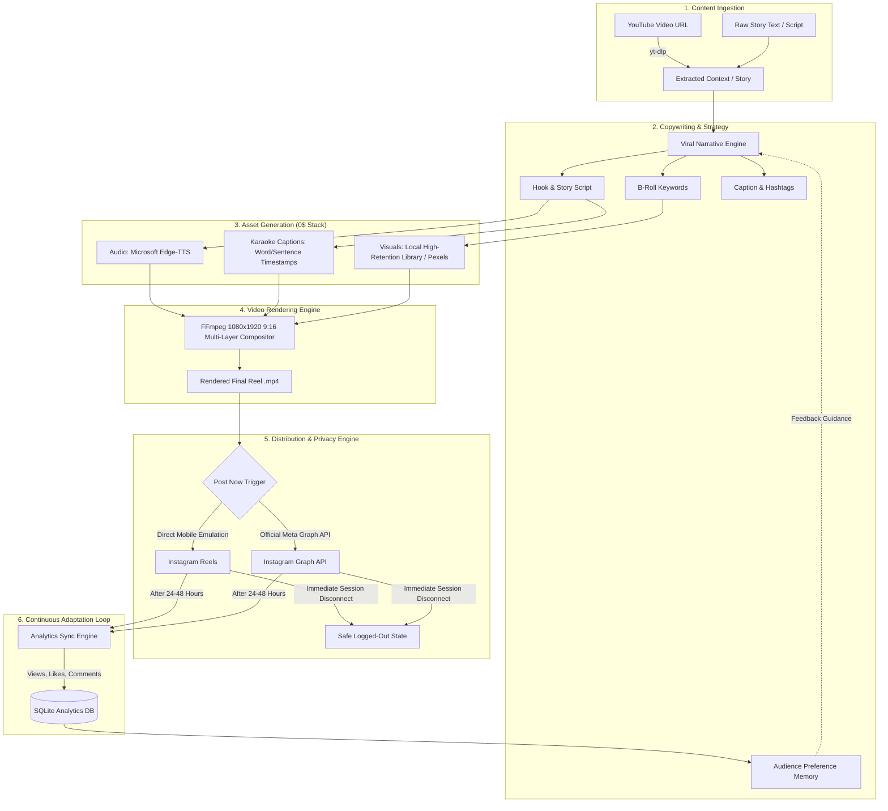

# Autonomous AI Video & Instagram Reels Pipeline 🚀

An end-to-end autonomous content creation, video rendering, automated publishing, and audience analytics pipeline built **100% free with open-source tools**. 

Input a text story or YouTube video link $\to$ The engine automatically synthesizes human-grade AI speech, burns animated karaoke captions, synchronizes continuous 9:16 vertical footage, uploads to Instagram Reels, and monitors audience retention to optimize future content generation.

---

## 🏗️ System Architecture



---

## ✨ Key Features

- **💸 100% Zero-Cost Stack**: Replaces expensive SaaS tools (ElevenLabs, Runway, Zapier) with free open-source equivalents (`edge-tts`, `imageio-ffmpeg`, `yt-dlp`).
- **🎙️ Natural Voiceover**: Synthesizes realistic human speech with natural cadence using Microsoft Edge Neural TTS.
- **💬 Burned Karaoke Captions**: Generates styled, high-contrast, black-bordered `.ass` subtitles positioned in the safe zone for mobile feeds.
- **🎮 Continuous Non-Repeating Backgrounds**: Automatically extracts smooth, uninterrupted 30–60 second slices from local 4K gameplay, satisfying loops, or stock footage.
- **🔒 Privacy-First Auto-Disconnect**: Connects only when explicitly told to post, uploads the video, and immediately terminates network sessions.
- **📈 Self-Optimizing Feedback Loop**: Periodically polls posted Reels for engagement metrics (views, retention, likes), analyzes what works, and adapts future storytelling prompts.

---

## 📂 Project Structure

```text
ai-video-pipeline/
├── config.py                 # Core paths, credentials loader & settings
├── ingestion.py              # YouTube extraction & viral script structuring
├── voiceover.py              # Edge-TTS voice generation & ASS subtitle builder
├── broll.py                  # Continuous video slicing & stock fetcher
├── video_engine.py           # FFmpeg 9:16 compositor & caption burning
├── ig_direct_publisher.py    # Desktop-level direct Instagram uploader
├── ig_publisher.py           # Official Meta Graph API publisher
├── feedback_agent.py         # Audience analytics sync & strategy optimization
├── database.py               # SQLite storage for posts & performance metrics
├── main.py                   # Central orchestrator CLI
├── assets/
│   └── backgrounds/          # Drop any vertical .mp4 loops here
├── output/                   # Rendered Reels ready for upload
├── requirements.txt          # Python dependencies
├── .env.example              # Environment variables template
└── .gitignore                # Security protection (credentials & media ignored)
```

---

## 🚀 Quickstart

### 1. Clone & Install Dependencies

```bash
git clone https://github.com/your-username/ai-video-pipeline.git
cd ai-video-pipeline
pip install -r requirements.txt
```

### 2. Configure Environment

Copy the example environment file:
```bash
cp .env.example .env
```
Edit `.env` with your credentials:
```ini
IG_USERNAME=your_instagram_username
IG_PASSWORD=your_instagram_password
```

### 3. Add Background Loops
Drop any vertical `.mp4` video (Minecraft parkour, GTA driving, satisfying footage) into:
```text
assets/backgrounds/
```
*(The engine will automatically pick and slice dynamic sections for each video).*

---

## 💻 Usage Guide

### 1. Render a Reel from Story Text (Safe Offline Mode)
Renders the `.mp4` video locally without posting so you can review it:
```bash
python main.py --story "Did you know that an octopus has three hearts and blue blood? When it swims, its main heart stops beating."
```

### 2. Use Your Exact Custom Script (`--verbatim`)
If you wrote a polished script and don't want the AI to alter any words:
```bash
python main.py --verbatim --story "Paste your exact narration here..."
```

### 3. Render and Publish Live Immediately
```bash
python main.py --post-now --story "Your viral story here..."
```

### 4. Publish the Latest Rendered Reel
```bash
python main.py --publish-last
```

### 5. Repurpose an Existing Video Link
Extracts context from a YouTube Short or video, creates a fresh narration script, and renders a new Reel:
```bash
python main.py --url "https://www.youtube.com/watch?v=..."
```

### 6. Sync Analytics & Update Audience Intelligence
Polls live views, likes, and comments from Instagram to train future script prompts:
```bash
python main.py --sync-stats
```

---

## 🛡️ Security & Privacy Notice

- **Never commit your `.env` or `ig_session.json` to public repositories.** The included `.gitignore` protects credentials, databases, and heavy media files automatically.
- All network connections terminate immediately after each upload completes.

---

## 📄 License

MIT License. Free for educational and personal use.
